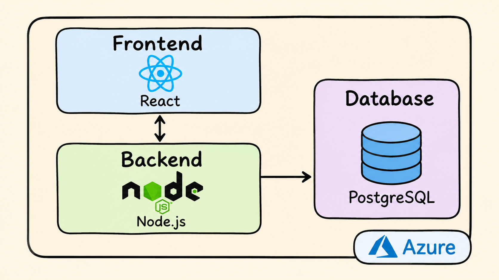

# UserHub

**UserHub is a user management web application being developed as a practical learning project to understand how modern enterprise applications are designed, developed, integrated and deployed.**

The primary goal of this project is to gain practical experience with application architecture, backend development, database management, authentication, cloud infrastructure and DevOps practices.

Rather than focusing solely on building a functional application, UserHub serves as an evolving learning environment for exploring how different application components work together, from local development to production deployment.

## Project Objectives

- Understand how frontend, backend and database components communicate in a three-tier application.
- Explore application development and integration.
- Understand user authentication, authorization and data management.
- Gain practical experience with Azure cloud services.
- Explore containerization with Docker.
- Practise infrastructure provisioning with Terraform.
- Understand application deployment and production environment management.

## Current Technology Stack

| Component | Technology |
|---|---|
| Frontend | React + Vite |
| Backend | Node.js + Express |
| Database | PostgreSQL |
| Authentication | JWT |
| Password Security | bcrypt |

## Current Application Architecture

## Current Implementation Progress

The following components have been implemented and tested:

- [x] Frontend application setup.
- [x] Responsive user interface.
- [x] User registration.
- [x] Backend API development.
- [x] PostgreSQL database integration.
- [x] Password hashing with bcrypt.
- [x] User login and JWT authentication.
- [x] Protected API routes.
- [x] User dashboard and profile page.
- [x] Frontend and backend integration.

## Project Roadmap

The project will continue to evolve as new technologies and concepts are introduced.

Planned areas of development include:

- [ ] Notification microservice.
- [ ] Docker containerization.
- [ ] Inter-service communication.
- [ ] Nginx and reverse proxy configuration.
- [ ] Terraform infrastructure provisioning.
- [ ] Azure deployment.
- [ ] Production environment configuration and management.

## Project Status

**Currently under active development.**

This repository documents the development process, technical decisions, challenges and lessons learned while building UserHub.

More documentation will be added as the project progresses.

## Application Architecture

